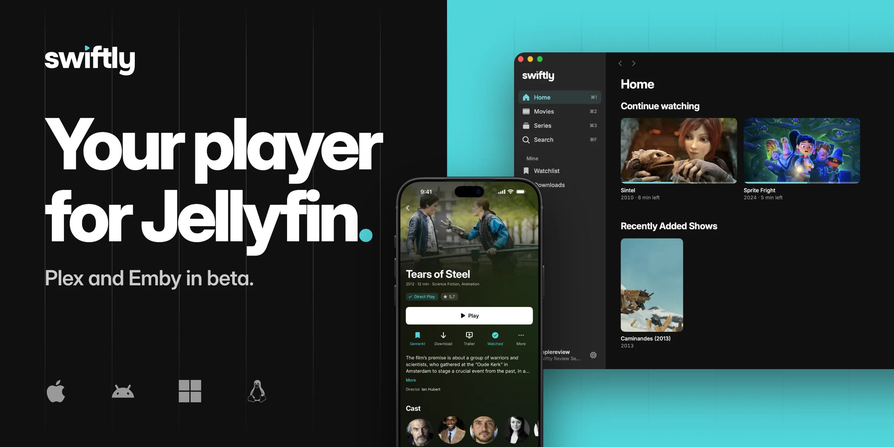
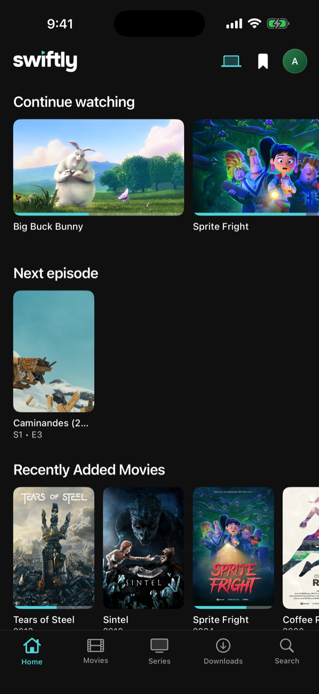
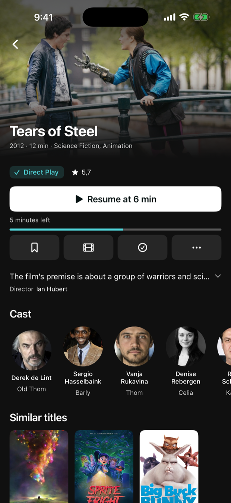
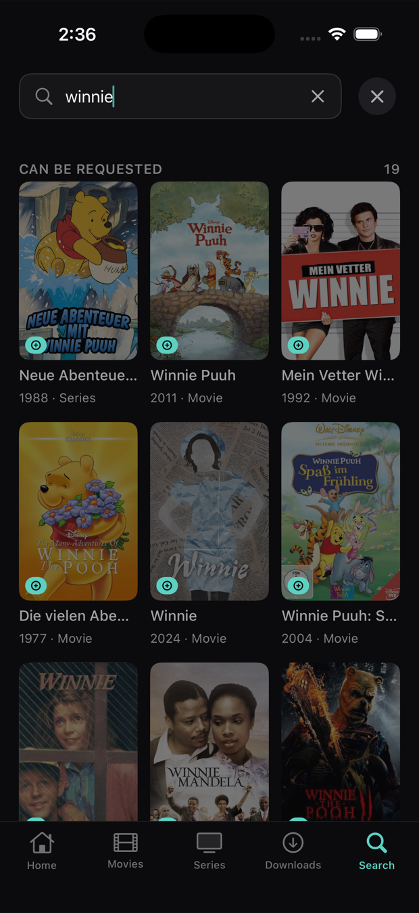
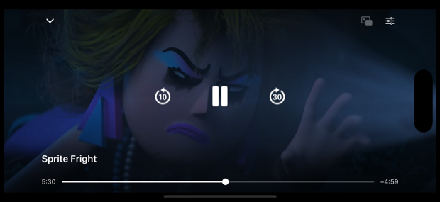

<div align="center">

<a href="https://swiftlyplayer.com"></a>

<p>
For iPhone, iPad, Apple TV, Mac, Android, Android TV, Linux and Windows.<br>
Every file plays as Direct Play or Direct Stream, never transcoded.
</p>

<p>
<a href="https://apps.apple.com/app/id6806824067"></a>&nbsp;&nbsp;<a href="https://play.google.com/store/apps/details?id=de.paulherter.swiftly"></a><br>
<a href="https://swiftlyplayer.com/supporter/"></a>
</p>

<p>
<sub>Swiftly is free and open source. <a href="https://swiftlyplayer.com/supporter/">Become a Supporter</a> to help keep it going.</sub>
</p>

<p>
<sub><a href="https://testflight.apple.com/join/BKtrBmbz">TestFlight beta</a> · <a href="https://github.com/paulherter/swiftly-player/releases/latest">Android APK</a> · <a href="#windows">Windows</a> · <a href="#linux">Linux</a> · <a href="https://discord.gg/MeGwfv3UwN">Discord</a></sub>
</p>

</div>

<br>

**Swiftly Player is a free, native client for your own media server:
Jellyfin, and in beta also Plex and Emby. It is meant to be plain, and to
just work.**

It opens, it finds your library, it plays. Most of it is the ordinary things
done properly, instead of a hundred switches nobody ever touches. Underneath,
it works to **never make your server transcode**, so the picture stays
untouched and your server stays cool.

It is one app for iPhone, iPad, Apple TV, Mac, Android, Android TV, Linux and
Windows: Direct Play, Picture in Picture, several accounts on one server, and
a running film that follows you from one device to the next.

<br>

## Screenshots

<table>
<tr>
<td width="25%"></td>
<td width="25%"></td>
<td width="25%"></td>
<td width="25%"></td>
</tr>
<tr>
<td align="center"><sub>Home</sub></td>
<td align="center"><sub>Detail</sub></td>
<td align="center"><sub>Requests</sub></td>
<td align="center"><sub>Picture in Picture</sub></td>
</tr>
</table>



<sub>The player, landscape.</sub>

<br>

## What is new in 1.1.0

- **Plex and Emby (beta).** Sign in to a Plex or Emby server the same way as to
  Jellyfin, on all eight platforms. Plex uses a short code or a QR code, Emby
  the usual login.
- **One player engine per system.** Apple devices play with AetherEngine,
  Android with Media3 and its own FFmpeg audio decoder, Windows and Linux with
  libmpv. [Players](Documentation/Players.md) lists what each one is and which
  licenses apply.
- **Pick the version.** If a title exists in several versions, Play asks which
  one, on every platform. The next episode keeps your choice.
- **Subtitle look.** One simple page for font, size, colours and background,
  with a live preview, on every platform.
- **Android TV matches Apple TV**, screen by screen: row layout, detail pages,
  search, profile and player.
- **Search on Apple TV and Android TV.**
- **Voice search on Apple TV.** The microphone key next to the keyboard opens dictation.
- **Android TV settings** sit in separate boxes with titles; account switches fade instead of jumping.
- **Faster Android start.** The home screen loads its rows once at launch and
  reloads on return only when the data is older than 30 seconds.
- **Trailers** try every available source in order before giving up.
- **Continue on this device** checks the playback plan first and only then
  stops the other device.

<br>

## Three things you will not find elsewhere

### Continue on this device

You are watching on the Apple TV. You get up, take your phone, and there is a
badge next to your profile picture. **Tap it, and the film carries on here,
from the same second.** The television stops on its own; you do not pause
anything, you do not scroll to find where you were.

It works in every direction: TV to phone, phone to Mac, Mac to TV, Android
included. If two of your devices are playing, Swiftly asks which one you meant.
Only your own account is offered, and only devices that are reachable.

### Several accounts on one server

Your household has one server and several accounts on it. Swiftly holds **all
of them at once**. Above "Sign out" there is "Add another account", and a strip
at the top of your profile switches between them: **no password, no signing
out, no waiting.** Continue Watching, Next Up and everything else change with
the account. Signing out affects only the account you are on.

### Every Apple TV profile keeps its own login

Switch the tvOS profile, and Swiftly is in that person's account: their
Continue Watching, their watched marks, their Top Shelf. Nobody signs anything
in or out; the television already asked who is watching.

<br>

## Everything else

### Watching

- **Never transcode.** The device profile declares containers, codecs and every
  subtitle format, so the server has no reason to re-encode. Undeclared
  subtitles are the most common cause of a needless transcode.
- **Resume** where you stopped, with the next episode following on its own.
- **Skip intro and recap** where your server knows about them.
- **Audio and subtitle tracks** switch while the film keeps running.
- **Playback speed**, with the position reported back to the server as you
  watch.

### Finding things

- **Several libraries** of the same kind; the app remembers which one you were in.
- **Search** across your libraries, with the season and episode you meant.
- **Collections** next to your libraries.
- **Requests through Seerr** for movies and shows that are missing.
- **Top Shelf**<sup>1</sup>: what you were watching sits above the app icon.

### On your devices

- **Picture in Picture**<sup>2</sup>, **lock screen and Control Centre**<sup>2</sup>
  with artwork and controls, and **media keys**<sup>3</sup>.
- **Quick Connect**, so you never type a password with a television remote.
- **Custom HTTP headers** per server, for Cloudflare Access, Authelia or
  Pangolin in front of your server. They go with every request to that server
  and nowhere else.
- **Downloads** in the quality you choose, for watching offline.

### Yours

- **No account with us, no ads, no tracking.** Nothing leaves your device
  except the requests to the server you enter yourself.
- **Free and open source**, MPL-2.0. All features are free, for everyone.

<sub>1 Apple TV · 2 iPhone, iPad, Android · 3 Linux, Windows, Mac</sub>

<br>

## Platforms

One app, one design, sized for the screen you are on. Server access, device
profile and playback timing are shared; only the views differ, and only where
distance, input or window size demand it.

| Platform | Where |
|---|---|
| iPhone, iPad, Mac, Apple TV | [App Store](https://apps.apple.com/app/id6806824067), one download for all four; the newest version lands first on [TestFlight](https://testflight.apple.com/join/BKtrBmbz) |
| Android, Android TV | Google Play beta and APK, see [Android](#android) |
| Linux | packages for apt, dnf, pacman and zypper, see [Linux](#linux) |
| Windows | installer, see [Windows](#windows) |

The TestFlight build's release notes name the handful of things to test. That
is usually five specific things, not "have a look around".

<br>

## Android

For phones and Android TV, Android 9 or newer. Same app as on the iPhone:
Direct Play through Media3, downloads, continue on this device, several
accounts, Seerr, skip intro, Picture in Picture and Quick Connect. Android TV
follows the Apple TV app screen by screen.

Joining the beta takes about two minutes. **Use the same Google account for every
step**, the one signed in to the Play Store on your device.

1. **Join the tester group:**
   [groups.google.com/g/swiftly-beta](https://groups.google.com/g/swiftly-beta),
   then *Join group*. You will not receive any emails.
2. **Become a tester:**
   [play.google.com/apps/testing/de.paulherter.swiftly](https://play.google.com/apps/testing/de.paulherter.swiftly),
   then *Become a tester*.
3. **Install** from that same page, or search for Swiftly Player in the Play
   Store, on your phone or on your TV.

<details>
<summary>The app does not show up</summary>

- It can take up to 15 minutes after step 2 before the Play Store lists it.
- *Item not found* almost always means a different Google account. Check which
  account the Play Store uses and repeat steps 1 and 2 with that one.
- Several Google accounts on the device: open both links in a browser where only
  that account is signed in.

</details>

**Rather install it yourself?** Take the APK from the
[latest release](https://github.com/paulherter/swiftly-player/releases/latest):
one APK for phones and Android TV. On a TV without a browser, use an app like
Downloader or `adb install`.

`Swiftly-<version>.apk` is the Play-signed build and the one to use with
[Obtainium](https://obtainium.imranr.dev). If Obtainium or Android shows a Play
Store window instead of installing, use `Swiftly-<version>-upload-signed.apk`
(filter regex `^Swiftly-.*-upload-signed\.apk$`). The two are signed with
different keys and cannot be installed over each other: uninstall one before
installing the other.

<br>

## Linux

> **Renamed in September 2026.** The app used to be called Swiftly for
> Jellyfin. The packages keep the name `swiftly-jellyfin`, so the commands
> below are unchanged.
>
> **If you added the package source before the rename**, the address moved.
> Point it at the new one — it is one line, and updates keep arriving with your
> normal system update:
>
> ```sh
> sudo sed -i 's|swiftly-for-jellyfin|swiftly-player|' /etc/apt/sources.list.d/swiftly.list   # apt
> sudo sed -i 's|swiftly-for-jellyfin|swiftly-player|' /etc/yum.repos.d/swiftly.repo          # dnf
> sudo sed -i 's|swiftly-for-jellyfin|swiftly-player|' /etc/pacman.conf                       # pacman
> ```
>
> The old address still answers, but it is no longer this project — it is a
> separate repository that lives on. Nothing will fail, and that is the
> awkward part: your package manager keeps getting valid replies, just from
> somewhere else, and you stop receiving updates without ever seeing an
> error.

One command. It works out which distribution you are on, adds the Swiftly
package source, and installs from it — so **updates arrive with your normal
system update**, like any other program.

```sh
curl -fsSL https://raw.githubusercontent.com/paulherter/swiftly-player/main/Linux/Installieren/swiftly-installieren.sh | bash
```

<details>
<summary>Or add the source yourself</summary>

**Debian, Ubuntu, Linux Mint, Pop!_OS, elementary, Zorin**

```sh
sudo install -d -m755 /etc/apt/keyrings
curl -fsSL https://paulherter.github.io/swiftly-player/swiftly.gpg | sudo tee /etc/apt/keyrings/swiftly.asc >/dev/null
echo "deb [arch=amd64 signed-by=/etc/apt/keyrings/swiftly.asc] https://paulherter.github.io/swiftly-player/deb ./" | sudo tee /etc/apt/sources.list.d/swiftly.list
sudo apt update && sudo apt install swiftly-jellyfin
```

**Fedora, Nobara, RHEL, Rocky, AlmaLinux**

```sh
sudo tee /etc/yum.repos.d/swiftly.repo <<'EOF'
[swiftly]
name=Swiftly Player
baseurl=https://paulherter.github.io/swiftly-player/rpm
enabled=1
gpgcheck=1
gpgkey=https://paulherter.github.io/swiftly-player/swiftly.gpg
EOF
sudo dnf install swiftly-jellyfin
```

**Arch, CachyOS, Manjaro, EndeavourOS, Garuda**

```sh
curl -fsSL https://paulherter.github.io/swiftly-player/swiftly.gpg | sudo pacman-key --add -
sudo pacman-key --lsign-key 5F31DEC1EAFF1AFFEA267E50B2ACD5E1D4945099
sudo tee -a /etc/pacman.conf <<'EOF'

[swiftly]
SigLevel = Required DatabaseOptional
Server = https://paulherter.github.io/swiftly-player/arch
EOF
sudo pacman -Sy swiftly-jellyfin
```

**openSUSE Tumbleweed**

```sh
sudo rpm --import https://paulherter.github.io/swiftly-player/swiftly.gpg
sudo zypper addrepo -f https://paulherter.github.io/swiftly-player/rpm swiftly
sudo zypper install swiftly-jellyfin
```

**Anything else** — build it yourself. Same script, one flag:
`… | bash -s -- --aus-quelle`. It pulls the dependencies from your
distribution, fetches Swift into `$HOME`, and builds.

**On Arch, CachyOS and Manjaro** the toolchain from swift.org is linked
against Ubuntu's library names, and the compiler will not start until
`libncurses.so.6` and `libxml2.so.2` are there. The installer creates those
two links under `~/.swift-compat` by itself, without a password and without
touching `/usr/lib`. If you skip the installer and run `swift build` by hand,
source `Linux/environment.sh` first — it does the same and says what is missing
before the build runs instead of after.

</details>

The packages are signed; the key's fingerprint is
`705D 676A 71BF 0121 804A  90BA C858 9885 A042 FB8B`.

**Requirements: GTK 4.14 and libmpv.** That is what rules out the older
releases — Debian 12 ships GTK 4.8 and could not draw the app at all. The
packages are built against Ubuntu 24.04 for glibc, which is the same floor
GTK already sets, so it costs nothing.

**Why packages and not a Flatpak.** Measured, not assumed: the GNOME 48
runtime carries GTK 4 but not a single libmpv library. A Flatpak would have
to build mpv and its FFmpeg itself.

<br>

## Windows

**[Download the installer](https://github.com/paulherter/swiftly-player/releases/latest)**
(`Swiftly-<version>-Setup.exe`), Windows 10 and 11, 64-bit. It installs over an
older version and updates itself: Settings → Check for updates asks GitHub for a
newer version, downloads the installer and runs it.

The installer puts Swiftly in Program Files (or your own folder if you run it
without admin rights), adds a Start menu entry and an optional desktop icon,
and comes with a proper uninstall.

**Windows will warn you the first time.** SmartScreen shows a blue box saying
the publisher is unknown: click **More info**, then **Run anyway**. The
installer carries no paid code-signing certificate, which is all that warning
says. Jellyfin's own desktop app is in the same position. The checksum is
listed with each release so you can verify the download.

It is the same program as on Linux: the same interface code, mirrored into the
Windows build. GTK 4, libmpv and the Swift runtime ship inside the installer.

<br>

## Documentation

- [Building](Documentation/Building.md): clone, generate the project, run the tests
- [Players](Documentation/Players.md): which player engine runs on which system, and where its source is
- [VLCKit](Documentation/VLCKit.md): why the VLCKit build used so far is patched, with the measurements
- [Device profile](Packages/JellyfinKit/Sources/JellyfinKit/DeviceProfile.swift): the file that decides whether your server transcodes, with the reasoning in its comments

<br>

## Requirements

- Your own server: Jellyfin **10.8 or newer**, or Plex or Emby (beta). Swiftly
  Player hosts nothing and has no account of its own.
- iOS 18, tvOS 18, macOS 15, Android 9, Windows 10, or a Linux desktop with GTK
  4.14 and libmpv, which the installer takes care of.

<br>

## Reporting bugs

The Discord is the fastest way: **https://discord.gg/MeGwfv3UwN**, with
channels for bug reports, feature requests and a beta chat.

On a beta build, reports against the changes named in the release notes are
worth the most, because they trace to a specific change. The single most useful
report is one where **the server transcoded when it should not have.** If your
dashboard says *Transcoding* instead of *Direct Play* or *Direct Stream*, include
the container, video codec, audio codec and subtitle format of that file.

<br>

## Sister app: Swiftly Music

[Swiftly Music](https://github.com/paulherter/swiftly-music) is the music app
for Jellyfin and Navidrome on the iPhone: Direct Play with FLAC, timed lyrics,
downloads, and Sonos with the iPhone as the remote. Its `JellyfinKit` is a copy
from this repository. The beta is open on
[TestFlight](https://testflight.apple.com/join/Ws5snXzX).

<br>

## Built with Claude

Swiftly Player was written together with Anthropic's Claude. The decisions, the
testing and the responsibility are mine; a good deal of the typing was not. It
seemed more honest to say that here than to let someone work it out.

<br>

## Support Swiftly

All the features you need are free, for everyone: no account, no ads, no tracking. It is built together, with bug reports, translations and pull requests from people like you. If you would like to say thanks, **[become a Supporter](https://swiftlyplayer.com/supporter/)**: €1.99 a month, or €19.99 once for good. Supporters get a few small extras on top (personalization such as extra app icons and looks, a heart in About, your name in the credits). The features themselves stay free for everyone.

<br>

## Contributors

Thank you to everyone who sends code, not only reports.

- **[Jens de Rond](https://github.com/Jensderond)** built chapters on the player timeline: the bar is split per chapter, the scrub preview shows the chapter name, and scrubbing snaps to chapter cuts ([#11](https://github.com/paulherter/swiftly-player/pull/11)).
- **[dzsayow](https://github.com/dzsayow)** made Dolby Vision files play in Dolby Vision on Android: they now go through the device's own Dolby Vision decoder instead of showing only the base layer ([#14](https://github.com/paulherter/swiftly-player/pull/14)).
- **[Andrey Lysikov](https://github.com/andrey-lysikov)** brought the Russian translation up to date, added finding Jellyfin servers on the local network, the alphabetical strip beside sorted lists, and a heading on Home that opens the library ([#35](https://github.com/paulherter/swiftly-player/pull/35), [#36](https://github.com/paulherter/swiftly-player/pull/36), [#37](https://github.com/paulherter/swiftly-player/pull/37), [#41](https://github.com/paulherter/swiftly-player/pull/41)).

<br>

## License

The code is licensed under the **Mozilla Public License 2.0** — see
[LICENSE](LICENSE). In short: you may use, change and redistribute it, and if
you change these files you publish your changes too.

**The name and the artwork are not covered by that license.** "Swiftly
Player" (formerly "Swiftly for Jellyfin"), the wordmark and the app icon remain the author's, all rights reserved; the license grants no rights to
them (MPL-2.0 section 2.3). A version you change and ship needs its own name,
icon and look, and must not be presented as Swiftly Player or as made by its
author.

Playback uses [VLCKit](https://code.videolan.org/videolan/VLCKit) under the
**LGPL-2.1-or-later** — see [Documentation/VLCKit.md](Documentation/VLCKit.md) —
and, in the versions with the new player engines,
[AetherEngine](https://github.com/superuser404notfound/AetherEngine)
(LGPL-3.0 with an App Store exception) with FFmpeg from
[FFmpegBuild](https://github.com/superuser404notfound/FFmpegBuild)
(LGPL-2.1-or-later), libdovi (MIT) and LibTrueHD (MIT, Apache-2.0) on Apple
devices, Media3 (Apache-2.0) with an FFmpeg audio decoder (LGPL) on Android, and
libmpv (LGPL) on Windows and Linux. Details and source locations are in
[Documentation/Players.md](Documentation/Players.md).

The libraries bundled with the apps keep their own licenses (LGPL for VLCKit,
libVLC, FFmpeg, libmpv and several others, plus BSD, MIT, Apache-2.0 and the SIL OFL for
the Inter font). The list, the license texts and the source offer for the LGPL
parts are in [THIRD-PARTY-NOTICES.md](THIRD-PARTY-NOTICES.md) and
[LICENSES/](LICENSES/).

The screenshots show films by the [Blender
Foundation](https://studio.blender.org/films/) — *Big Buck Bunny*, *Sintel*,
*Agent 327*, *Sprite Fright* and others — released under Creative Commons
Attribution.
